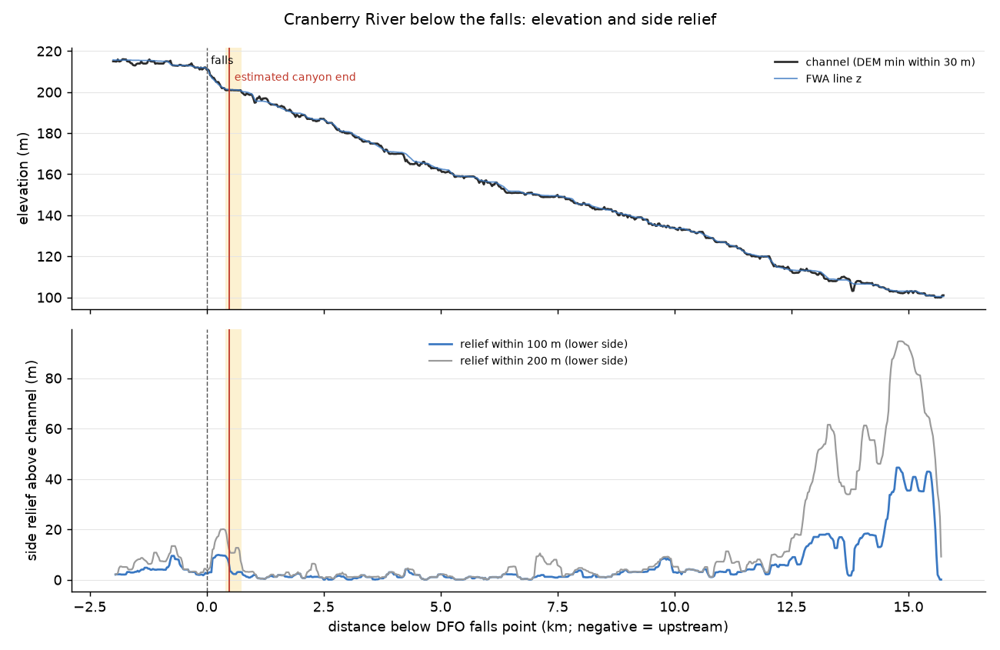
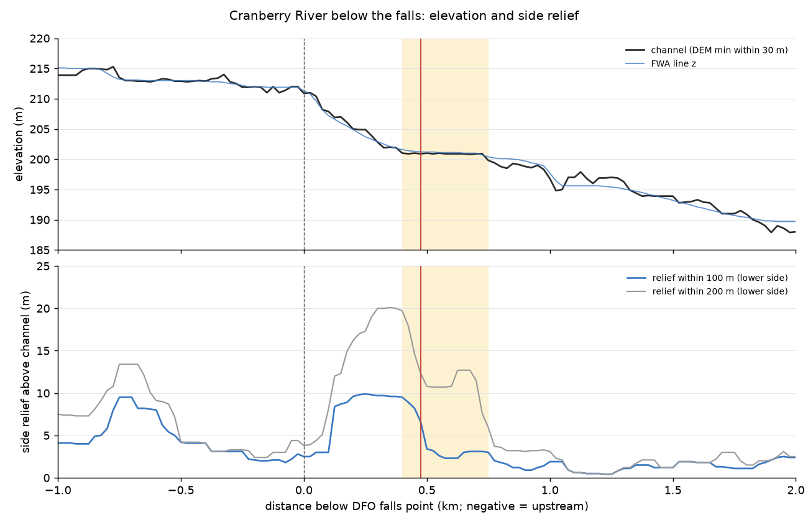

# Cranberry River Canyon: where does it end downstream?

Rule: `r6:cranberry_river.r1`, "between fishing boundary signs upstream of and downstream of Cranberry River Canyon".
Canyon top = DFO falls point 55.56407, -128.68426 (Fs97-6/2129). This is analysis only; no curated data was changed.

## Estimate

| | |
|---|---|
| **Canyon downstream end (best estimate)** | **55.56202, -128.68996** |
| Distance below the falls (along FWA line) | **~475 m** (FWA route measure 15 277 m above the Nass confluence) |
| Uncertainty range | 400–750 m below the falls (55.56240,-128.68898 to 55.56067,-128.69354) |
| Confidence | low to moderate (see caveats) |

## Method

- Line: FWA stream `BLUE_LINE_KEY 360885423` (Cranberry River) from `data/source/bc_fisheries_data.gpkg`, read-only.
  The falls point snaps 2.3 m onto it, at route measure 15 752 m (15.75 km above the Nass confluence).
- DEM: AWS Terrarium tiles at zoom 14 (~5 m pixels; the source data is coarser, about 20–30 m), bilinear,
  using the repo's `ElevationSampler` tile cache (`pipeline/atlas/waters/added_streams/dem.py`).
- Stations every 25 m, from 2 km above the falls down to the Nass confluence (711 stations). At each one, a
  ±300 m cross-section perpendicular to the line, sampled every 10 m:
  - channel = lowest DEM value within 30 m of the line (FWA line z agrees within ~1 m);
  - relief100 / relief200 = the highest ground within 100 / 200 m on each side, minus the channel. The
    reported value is the **lower** of the two sides, so a single valley wall does not count as a canyon;
  - gradient from the channel elevation over 200 m.
- Canyon end = where relief100 falls back below ~5 m and the gradient returns to the valley's normal.

## Profile numbers

| Reach (m below falls) | Channel drop | Gradient | relief100 | relief200 |
|---|---|---|---|---|
| −2000 to 0 (above falls) | 215 → 211 m | ~0.2 % | 2–5 m | 3–9 m |
| **100–450 (confined step)** | 208 → 201 m | **~2.0 %** | **~9.6 m** | **~17 m** |
| 500–750 | flat at 201 m | ~0 % | 2–3 m | 10–14 m (one terrace) |
| 1 000–12 000 (valley normal) | 197 → 115 m | 0.68 % | 1.6 m (p90 4.1) | 2.2 m |
| 12 500–15 750 (near the Nass) | 113 → 100 m | 0.4 % | 15–45 m | 35–90 m |

The transition at 25 m resolution:

| m below falls | lat, lon | channel (m) | relief100 | relief200 | gradient % |
|---|---|---|---|---|---|
| 400 | 55.56240, -128.68898 | 201.0 | 9.6 | 20.3 | 0.9 |
| 450 | 55.56215, -128.68963 | 201.0 | 8.2 | 14.6 | 0.5 |
| **475** | **55.56202, -128.68996** | 200.9 | 6.6 | 12.3 | 0.5 |
| 500 | 55.56189, -128.69028 | 201.0 | 3.4 | 10.8 | 0.05 |
| 600 | 55.56143, -128.69164 | 200.9 | 2.2 | 10.8 | 0.05 |
| 800 | 55.56022, -128.69365 | 198.8 | 1.8 | 3.2 | — |




## Reading it

The DEM shows a short, confined, steeper step just below the falls. Over about 100–450 m the river drops about
7 m (about 3× the valley gradient) between banks about 10 m high on both sides. By 500 m the relief drops to
the valley's normal, and by about 750 m the one-sided terrace is gone too. Below that, the Cranberry runs in an
open, low-relief valley for about 11 km.

## Caveats (why confidence is low)

1. **DEM resolution.** The Terrarium source in this area is about 20–30 m. A narrow bedrock slot under ~30 m wide
   is under-resolved or filled in, so the real gorge may run further than the DEM shows. The 400–750 m range
   covers the terrace edge but not a slot the DEM cannot see.
2. **A second, larger confined reach exists near the Nass** (12.5–15.75 km below the falls, measure 0–3.2 km),
   with 35–90 m relief, where the river cuts through Nass terraces. If the regulation's "Cranberry River Canyon"
   means that lower reach, this estimate is wrong. The forum note ("falls about 5 km up, closed below the falls")
   does not settle which reach it is. The falls are 15.75 km above the mouth, and I did not check where the
   highway or FSR crossing is relative to the falls.
3. Whether the falls point is really the canyon's top is taken as given. Above the falls the relief is low
   (2–5 m), so there is no canyon upstream either.

## Proposed curated split (not added)

```json
{
  "id": "cranberry_river__canyon_bottom_estimate",
  "label": "Cranberry River Canyon (downstream end, estimated)",
  "point": [-128.68996, 55.56202],
  "confidence": "low",
  "note": "Estimated from AWS Terrarium DEM (z14) cross-sections every 25 m along FWA BLK 360885423: a confined step (relief ~10 m both sides within 100 m, ~2% grade) runs from the DFO falls point (Fs97-6/2129) to ~475 m downstream, then returns to the valley's normal (relief <3 m, 0.7%). Range 400-750 m below the falls. Narrow gorges below DEM resolution may extend further. See handoff/PLAN/curation-review/cranberry-canyon/README.md."
}
```

## Files

- `profile.py`: samples the profile (run from repo root: `PYTHONPATH=. python handoff/PLAN/curation-review/cranberry-canyon/profile.py`)
- `plot.py`: draws the PNGs and writes the GeoJSON and HTML map
- `profile.csv`: every 25 m station (d_below_falls, measure, lon/lat, ch_dem, fwa_z, rel100, rel200, rel100_max, w20, w40)
- `cranberry_canyon.geojson`, `map.html`: the falls point, the estimate, the range segment and the profile line (Leaflet on OpenTopoMap)
