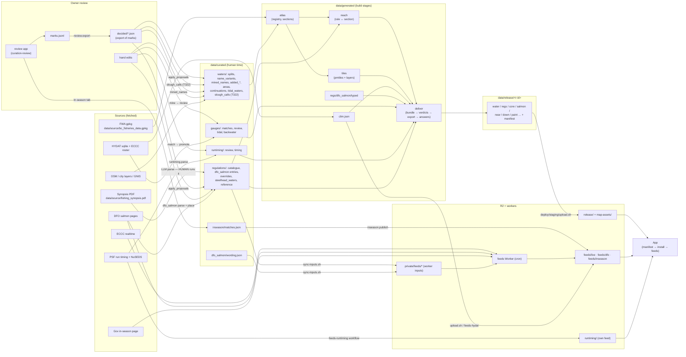

# Data flow — every stream, end to end (T324 steps 1, 2, 4)

2026-10-30. For the owner. Planning only: nothing was moved, built or changed to write this.
In flight while this was written: **T322** (slough files moved to `data/curated/sloughs/` and
`data/generated/sloughs/`; `waters/slough_calls.json` + the registry fold added, fold **OFF** until its own side build).

## The short answer

**"I thought the marks got converted into our real curated data type?"** Partly. Today a decision makes **three
hops**, and only some domains finish the trip:

```
marks.jsonl  ──export──▶  decided/<domain>.json  ──apply tool──▶  the real file  ──▶  build
(review log)              (a COPY of the marks,                 (splits.json,
                           whole mark lines + provenance)         catalogue, mined_names…)
```

`decided/` is **not** the real data type. It is the marks again, filtered per domain, with every review field still
in (prints, answers, seconds). The real file is one more tool away, and that tool is different for every domain.
That is the awkward part.

| domain | marks in force | lands in the real file? | read by the build? |
|---|---|---|---|
| tidal | 1,170 verified, 6 unsure, 1 wrong | **yes**: 33 cuts in `waters/splits.json` (applied one commit each by `apply_proposals`); ~1,130 are "tidal at the mouth" = no edit; 10 whole waters are in `waters/tidal_waters.json`, typed by hand | yes (reach + tiles read the cuts and `tidal_waters.json`) |
| DFO extents | 49 verified, 4 unsure | **yes, as applied**: `apply_proposals` → `entries/dfo_salmon/region-*.json` + `splits.json` | yes (reach) |
| entries / rules | 35 verified, 2 wrong | **yes, as applied**: `apply_proposals` → `entries/catalogue/region-*.json` + `splits.json` | yes (reach + deliver) |
| sloughs | 811 "stream" calls (946 verified, 135 cleared) | **in flight (T322)**: `tools.slough_calls` → `waters/slough_calls.json` | **not yet**: the registry fold is written but OFF |
| ponds (Q154) | 81 (61 pool, 19 real lake) | **no** — `decided/ponds.json` has **no reader** | no |
| names | **0 marks** | the decisions are in **Python code** (`pipeline/regs/review/names.py` `OWNER`) + auto rules → `tools.mined_names` → `waters/mined_names.json` (one accepted name, Sheldens Creek, not yet written) | yes (atlas) |
| splits (calls on existing cuts) | 0 | — | — |
| "proposal" scope | 7 (from the retired accept step) | exported nowhere | no |

Gauges, in-season, run timing, continuations and the steelhead list have **no marks**: their curated file already
is the real file (good — that is the target shape).

---

## 1. The map



The build itself is four stages (`python -m pipeline build --graph`): **clim**, **reach**, **tiles**, **deliver**
(+ **atlas** only with `--atlas`). No stage reads `marks.jsonl` or `decided/` (proved by the T266 sandboxed build).

---

## 2. The streams, one table each

Columns: **file** · **written by** · **read by** · **refreshed when** · **human time in it**.

### 2.1 Waters (the atlas shape)

| file | written by | read by | refreshed | human time |
|---|---|---|---|---|
| `data/source/bc_fisheries_data.gpkg` | `data/fetch_data.py` | atlas | new FWA vintage | none |
| `waters/splits.json` | hand + `apply_proposals` (one commit per proposal) | atlas (sectionizer), reach, review tools | each applied mark | **high** — every cut |
| `waters/name_variants.json` | hand | atlas (registry) | rare | high |
| `waters/mined_names.json` | `tools.mined_names` from `decided/names.json` + `names.OWNER` (code) + auto rules | atlas (`registry/mined.py`) | names review | medium — decisions live in code |
| `waters/added_lakes.geojson`, `added_areas.geojson` | hand-drawn | atlas, `area_splits` | rare | high |
| `waters/added_streams.json` | `added_streams/build_dataset.py`, promoted | atlas | never re-run (live `blk` ABI) | high (approved) |
| `waters/areas.json` | hand | atlas, tiles key | rare | high |
| `waters/continuations.json` | hand (reviewed / refused) | deliver (`bundle/continuation.py`) | per review | medium |
| `waters/tidal_waters.json` | hand (T212) | reach (`outside.py`), tiles key | per owner call | low, but it is tidal truth #2 |
| `waters/slough_calls.json` | `tools.slough_calls` from `decided/sloughs.json` (**T322, in flight**) | atlas registry fold (**OFF**) | after slough marks | high (811 calls) |
| `waters/ungazetted.json`, `sub_lake_areas.json` | hand | **nothing** (worklists) | — | medium |
| `sloughs/page-marks-2026-10-28.json` | review page (moved here by T322) | `review/slough.py` (pre-marks), by literal path | done | medium |

### 2.2 Regulations (the book)

| file | written by | read by | refreshed | human time |
|---|---|---|---|---|
| `data/source/fishing_synopsis.pdf` | fetch | extraction | new synopsis | none |
| `entries/catalogue/region-*.json` | LLM parse (**owner runs**) + ingest, `apply_proposals`, hand | reach, deliver, review app | new synopsis / each applied mark | **highest** |
| `regulations/overrides.json` | hand | reach (`covered.py`), parser, review | rare | high |
| `regulations/steelhead_waters.json` | `regs/steelhead/known_waters.py`, then a human copies it in | reach, deliver | rare | medium |
| `regulations/reference/*.md` | hand transcription | deliver (glossary) | new synopsis | high |
| `regulations/cross_references.json` | old corpus extraction | **only a test** | — | low |
| `review/marks.jsonl` | review app (append-only) | exporter, review app, tickets/precheck | every mark | **highest** |
| `review/proposal_overrides.json` | hand | proposals, DFO suggest, review | per call | low |
| `decided/*.json` | `pipeline.regs.review.export` | apply tools only | after marks (`--check`) | none of its own (a copy) |

### 2.3 DFO salmon

| file | written by | read by | refreshed | human time |
|---|---|---|---|---|
| DFO pages | — | Python parse (`regs/dfo_salmon`) and worker (`app/workers/feeds/src/dfo`) | 4×/day in season (worker) | none |
| `entries/dfo_salmon/region-*.json` | parse + placing + `apply_proposals` | reach, deliver, review app, **R2 private** via `sync-inputs.sh` | per placement | high |
| `dfo_salmon/wording.json` | hand (T321) | worker via R2 private (compiled-in fallback copy too), `dfo_salmon/wording.py` by literal path | per wording edit | medium |
| `generated/regs/dfo_salmon/typed` | `dfo_salmon.live` | deliver (bundle `dfo` key) | per run | none |
| `generated/regs/dfo_salmon/feed` | Python feed | `upload.sh` seeds `feeds/dfo` (`--ignore-existing`) | per release | none |
| R2 `feeds/dfo/` | feeds Worker | app | each worker run | none |

### 2.4 Gauges

| file | written by | read by | refreshed | human time |
|---|---|---|---|---|
| `data/source/hydat.sqlite3`, `bc_hydrometric_stations.json` | `scripts/hydat-fetch.sh`, fetch | clim, match, `sync-inputs.sh` (roster → R2 private) | new HYDAT (feeds-hydat, manual) | none |
| `generated/gauges/match.json` | `gauges.generate.match` | promote | rare | none |
| `gauges/matches.json` + `candidates.json` | `gauges.generate.promote` | deliver (bundle) | rare (one frozen file) | high (approved) |
| `gauges/review.json` | hand (231 decisions) | match / promote | per review | high |
| `gauges/tidal.json`, `backwater.json` | hand | deliver (`consume/tidal.py`) | rare | medium |
| `gauges/waterbody_type.json` | scraped from ECCC once | promote | rare | none — it is source data |
| `generated/gauges/feeds/clim.json` | clim stage / feeds-hydat | deliver; R2 `feeds/live/clim.json` | new HYDAT / new year | none |
| R2 `feeds/live/` | feeds Worker (every 30 min) | app | 30–60 min | none |

### 2.5 In-season changes

| file | written by | read by | refreshed | human time |
|---|---|---|---|---|
| gov in-season page | — | feeds Worker → R2 `feeds/inseason/index.json` | 4×/day in season | none |
| `inseason/matches.json` | review app In-season tab (its one non-mark write) or hand | `inseason.publish` → R2 `feeds/inseason/matches.json` (`sync-inputs.sh`) | per match | medium |

The app reads both and draws a banner. Nothing in the build reads in-season (informational only).

### 2.6 Run timing

| file | written by | read by | refreshed | human time |
|---|---|---|---|---|
| PSF + NuSEDS pages | — | `runtiming.parse` (Mac) and the `feeds-runtiming` workflow (its own fresh parse) | manual | none |
| `runtiming/timing.json` | `runtiming.parse` | deliver | manual | **none** — parsed, kept in git because the pages may not be re-hosted |
| `runtiming/review.json` | hand | parse, extract, bundle | rare | medium |
| R2 `runtiming/` | `feeds-runtiming` workflow | app (Runs tab) | manual | none |

### 2.7 Release → app

| file | written by | read by | refreshed | human time |
|---|---|---|---|---|
| `data/release/<r-id>/*` + `manifest.json` | deliver | `upload.sh` | each build | none |
| `data/release/LATEST` | promote step (Claude may, owner 10-28) | `upload.sh` | each promote | a decision |
| R2 `release/` + `map-assets/` | `upload.sh` (staging: Claude; prod: owner) | app boot (`app/packages/data/src/release/boot.ts`): manifest → install → paint | each upload | none |

---

## 3. Problems found

### Human work outside `data/curated`
| where | what | fix |
|---|---|---|
| `pipeline/regs/review/names.py` `OWNER` | the owner's single-name decisions, **in Python code** | rows in `waters/mined_names.json` |
| `handoff/PLAN/curation-review/tidal/owner-decisions.json` | owner's tidal calls (Capilano, Cowichan) before the Tidal tab; read by `proposals.py` | fold into the tidal lock |
| slough page verdicts | were in `handoff/` | **done by T322** → `data/curated/sloughs/` |

### Two files say the same thing
| truth | files |
|---|---|
| what is tidal | `decided/tidal.json` (1,170 calls) · tidal flags on 33 cuts in `waters/splits.json` · `waters/tidal_waters.json` (10 whole waters) · `owner-decisions.json` in handoff. The ~1,130 "tidal at the mouth" calls exist **only** as marks. |
| every decision | `marks.jsonl` and `decided/*.json` (a full copy of each mark line) |
| split confidence | `review/proposal_overrides.json` beside the split it is about |
| DFO wording | `dfo_salmon/wording.json` and a compiled-in copy in the worker |
| run timing | `runtiming/timing.json` (Mac parse) and the workflow's own parse |

### Files no one reads
- `decided/ponds.json` (80 decisions) — no reader; Q154 is OFF. **Done by T329:** ponds closed, file deleted.
- `decided/names.json`, `decided/splits.json` — no records.
- `regulations/cross_references.json` — only a test reads it.
- `waters/sub_lake_areas.json` — no code reader (a worklist, not declared in config like `ungazetted.json` is).
- 7 `proposal`-scope marks — exported nowhere.

### Readers that skip the curated config (AGENTS 36)
- `regs/review/slough.py` → `PAGE_MARKS` literal path.
- `regs/dfo_salmon/wording.py` → `REGISTRY` literal; `wording.json` is not in `config.yaml` at all.
- `regs/review/proposals.py` → `TIDAL_DECISIONS` in `handoff/`.
- `curation-review/backend/inseason.py` → `CURATION_INSEASON_MATCHES` env var can repoint a curated file (curated paths are never env-overridable).
- `.github/workflows/feeds-sync-inputs.yml` does **not** sync `wording.json`; its Mac twin `sync-inputs.sh` does. Two lists.

### Generated files in `handoff/`
Code reads or writes these, but they are machine output:
`curation-review/tidal/{tidal-candidates,tidal-preverify,tidal-edits,tidal-osm-landmarks,tidal-web}.json`, `tidal/pass2/`,
`dfo-suggestions.json`, `dfo-preverify.json`, `dfo-split-hunt.json`, `entry-split-suggestions.json`,
`t89-awaiting-water.json`, `q154/sample.json`, `name-variants/candidates.json` (+ its script `mine.py`),
`proposals/`. Readers: the review app backend, `regs/review/*`, `regs/dfo_salmon/*`, `tools/audit/tidal_*`.
**Done by T330 (2026-10-30):** all 16 moved with `git mv` to `data/generated/review/` (same sub-paths), read through
`GENERATED.review`; `tidal/owner-decisions.json` stays for T326.

### Other
- `gauges/waterbody_type.json` is scraped source data filed as curated.
- The deliver key hashes the **whole** curated tree (minus marks/decided), so a review-only file (page marks, gauge
  candidates) reruns deliver.
- `data/release/` holds 27 release folders; the rule is live + previous.

---

## 4. End state: one final file per data type

The rule: **one file per data type, in the shape the build uses, no review fields, read through `CURATED`, by one
loader.** Marks stay what they are for: the log of a review that is still open.

| data type | final file | read by (one loader / stage) | status |
|---|---|---|---|
| cuts | `waters/splits.json` (confidence folded in from `proposal_overrides.json`) | atlas (sectionizer) | exists |
| tidal limits | **`waters/tidal.json`** (new; replaces `tidal_waters.json` + the tidal flags + `decided/tidal`) | reach (`outside.py`); tiles via the same loader | to make (T326; write-through then targets it) |
| sloughs | `waters/slough_calls.json` | atlas (registry fold) | exists (T322) |
| ponds | none — owner 2026-10-30: a pond call only confirms the lake default | — | **closed** (T329) |
| names | `waters/mined_names.json` (owner rows move in from code) | atlas (registry) | exists |
| DFO places | `regulations/entries/dfo_salmon/region-*.json` | reach | exists |
| regulations | `regulations/entries/catalogue/region-*.json` | reach + deliver | exists |
| gauges | `gauges/matches.json` + `gauges/review.json` | deliver | exists; no marks |
| in-season | `inseason/matches.json` | `inseason.publish` | exists; no marks |
| run timing | `runtiming/review.json` (authored); `timing.json` moves out of curated | deliver | relabel |
| DFO wording | `dfo_salmon/wording.json` (declared in config) | worker + `wording.py` | declare |

### Example records

`waters/tidal.json` — one row per ocean-entering water, the answer and where it came from:
```json
{"water": "gnis:5922", "limit": "split", "split_id": "capilano_river__cn_railway_bridge_tidal_boundary",
 "why": "words: CN Railway Bridge", "decided": "2026-10-28", "mark": "1f0c…"}
{"water": "blk:360875001", "limit": "mouth", "decided": "2026-10-29", "mark": "9a2e…"}
{"water": "gnis:12345", "limit": "whole", "decided": "2026-10-29", "why": "Fraser delta channel"}
```
The cut point stays in `splits.json` (the cutter needs it); `tidal.json` only says which cut is the tidal limit.
That removes the tidal flag from splits.json and replaces `tidal_waters.json`.

`waters/slough_calls.json` (T322's shape, already final):
```json
{"wbk": "328947490", "call": "stream", "date": "2026-10-29", "mark": "85bdfc14b03b", "reviewer": "dawson"}
```

`waters/pond_calls.json` (if kept):
```json
{"wbk": "329248389", "call": "lake", "date": "2026-10-29", "mark": "f97667997d8c"}
```

`waters/mined_names.json` owner row (from `names.OWNER`):
```json
{"target": {"blks": ["360846083"]}, "names": [{"name": "Sheldens Creek", "source": "owner", "decided": "2026-10-29"}]}
```

`mark` is the 12-hex sha of the mark line — enough to find the history in the archive, nothing else from the review.

### Marks write through to the final file (T325, owner 2026-10-30)

Owner: *"I don't want to have to individually lock everything. It should just work naturally from marks, and when
reviewing items it should take my reviews and add to the curated items."* There is **no lock step**.

Marking stays one click in the review app (a line appended to marks.jsonl, never edited). Right after the save, the
server runs **that domain's apply** (`curation-review/backend/write_through.py` → `pipeline.regs.review.apply.run`):
export the marks to `decided/`, then the domain's writer.

| domain | writer | final file | when |
|---|---|---|---|
| sloughs | `tools.slough_calls` | `waters/slough_calls.json` | in the request (< 1 s) |
| names | `tools.mined_names` | `waters/mined_names.json` | in the request |
| dfo / entries / splits | `apply_proposals --scope …` (binding check, one `git commit --` per proposal) | `entries/dfo_salmon/`, `entries/catalogue/`, `splits.json` | background, debounced 1.5 s (binding check: seconds warm, ~20 s cold) |
| tidal | `apply_proposals --scope tidal` (current path; T326 still owes `waters/tidal.json`) | `splits.json` tidal flags/cuts; `decided/tidal.json` | background |
| ponds | — (closed: nothing reads a pond call, T329) | — | — |

- **Batch** (accept all visible) is one request → one apply.
- **Refused** (failed binding check, uncommitted changes in the file, a stale slough mark, conflicting decisions, any
  error): the mark stays; the reason is returned (in-request) or held per item (`GET /api/review/write-through`),
  shown on the item and in the app's amber "not in the curated file" list, and logged to
  `data/generated/review/write-through.jsonl`. A later save of the same domain retries it.
- **A cut that changes** (a new split, every tidal cut above the mouth) waits for its side rebuild as before (heavy, by
  hand); the app lists those marks as "waits for a side rebuild" with the commands.
- **Atomic**: every curated and decided write is temp file + rename; `apply_proposals` puts a file back if its commit
  fails.
- **Only over the curated store**: a server on a temp marks store (tests, a second copy) writes no curated file unless
  `CURATION_WRITE_THROUGH=1`; `=0` turns it off.
- The file writers write their file and leave committing to the owner's normal commit; the proposal writer commits
  per proposal (as before).
- A tab whose queue is empty shows **done**. `closed.json` keeps only domains that feed nothing (ponds).

`python -m pipeline.regs.review.apply [domain ...] [--dry-run]` is the same apply by hand — a catch-up after marks
were made with the server off.

The `lock` tool (built earlier the same day) is **removed**: no lock, no "locked" tab, no reopen command. The
original lock proposal (refuse-until-finished, side-build proof, archive marks) is dropped; the side-build proof that
a domain's marks are fully in its final file is still a good one-off check before deleting a domain's marks path
(T326 tidal), but it is not a step the owner runs per domain.


---

## 5. Cleanup tickets (proposed — not created)

| # | title | one line |
|---|---|---|
| 1 | Write-through (was: lock tool) | Marks reach their final file on save; no lock step (§4, T325, owner 2026-10-30). |
| 2 | Lock tidal | `waters/tidal.json` replaces `tidal_waters.json`, the splits tidal flag, `decided/tidal` and handoff `owner-decisions.json`. |
| 3 | Lock names | Move `names.OWNER` out of code into `mined_names.json`; write Sheldens Creek. |
| 4 | Lock sloughs | After T322 is approved: archive slough marks, `page-marks` and `decided/sloughs`. |
| 5 | Ponds: reader or archive | Owner decides whether Q154 calls drive anything; then a `pond_calls.json` or an archive. |
| 6 | Generated review files out of handoff | Move `curation-review/{tidal/*, dfo-*, entry-split-suggestions, t89-awaiting-water, q154/sample, name-variants/candidates, proposals/}` to `data/generated/review/`, read via `GENERATED`. |
| 7 | Every curated file in config | Declare `dfo_salmon/wording.json`, `sloughs/page-marks`, `sub_lake_areas.json`; read them through `CURATED` (`wording.py`, `slough.py`). |
| 8 | No env override of curated paths | Drop `CURATION_INSEASON_MATCHES` (and any other `CURATION_*` that repoints a curated file). |
| 9 | One sync list | `feeds-sync-inputs.yml` and `sync-inputs.sh` read the same key list; the workflow is missing `wording.json`. |
| 10 | Dead curated files | Delete or declare `regulations/cross_references.json` (test only) and `waters/sub_lake_areas.json` (no reader). |
| 11 | Split confidence into splits.json | Fold `review/proposal_overrides.json` into the split records (with T326). |
| 12 | Source data out of curated | `gauges/waterbody_type.json` (scraped) and `runtiming/timing.json` (parsed) move to `data/source/`; note which run-timing parse the app trusts. |
| 13 | Retired marks | Archive the 7 `proposal`-scope marks from the old accept step. |
| 14 | Narrow the deliver key | Hash only the curated files deliver reads, so a review-only file does not rerun deliver. |
| 15 | Prune releases | 27 folders in `data/release/`; keep live + previous. |
| 16+ | ~~Lock DFO, lock regulations~~ | Not needed: write-through keeps them current (owner 2026-10-30). |
