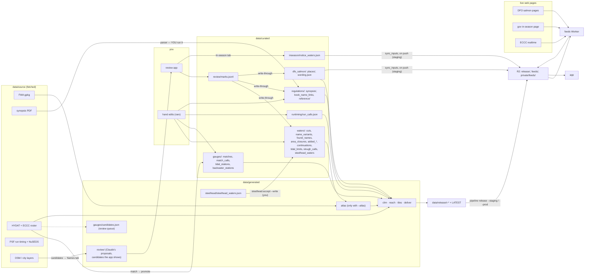

# Data flow — every stream, end to end, as built (T324, 2026-11-05)

For the owner. The pipeline **as it is after T324** (the naming pass, machine output out of curated, the fast curated
check, the steelhead accept command, one copy of the DFO wording, inputs synced on push). What the owner chose and why
is `data-flow-decisions.md`; this is the map. Every curated folder also has its own README (`data/curated/*/README.md`).

## The short answer

**A review decision makes one hop.** You save a mark in the review app; the mark is appended to
`data/curated/review/marks.jsonl` (the log, never edited) and the server writes it straight into its domain's final
file. The build reads only the final files.

```
review app ──save──▶ review/marks.jsonl ──write-through (apply)──▶ the final curated file ──▶ build ──▶ release ──▶ app
                     (the log)                                     (cuts.json, synopsis/,
                                                                    places/, tidal_limits.json,
                                                                    slough_calls.json, found_names.json)
```

There is no `decided/` copy any more (T325/T408): the apply reads the marks in memory.
`python -m pipeline.regs.review.apply [domain] [--dry-run]` is the same apply by hand.

**Three kinds of data**, one folder each: `data/source/` (fetched — costs bandwidth), `data/generated/` (computed —
costs CPU; includes Claude-made proposal files and the gauge review queue), `data/curated/` (the owner's decisions and
hand-made data — costs human hours). Curated names: `*_calls.json` = your per-item decisions, `*_waters.json` = a list
of waters, `*_stations.json` = a list of gauges.

---

## 1. The map



---

## 2. The build and the release

**One command ships:** `python -m pipeline release --staging` = build → checks → promote LATEST → staging upload,
stopping at the first failure, resumable (finished stages are cached). `--prod <r-id>` re-uploads the same checked
bytes to production (yours only). `--dry-run` prints the plan.

The build (`python -m pipeline build`, which `release` runs) is, in order:

1. **Fast curated check** (T324): `python -m pipeline.tools.audit.check_curated --waters` — the hand-edited waters
   files (`name_variants`, `area_closures`, `added_areas` / `added_lakes` / `added_streams`, `continuations`,
   `unmapped_waters`): shape and references, under a second. A bad hand edit stops the build here.
2. **Preflight**: source files present; promoted artifacts not stale (`check_curated --ci`); tippecanoe.
3. **Stages**, each only when its key moved: `clim` (gauge envelope from HYDAT), `reach` (every rule bound to its
   sections), `tiles` (map geometry), `deliver` (bundle → verdicts → export → answers → release). The **atlas** is
   built only with `--atlas` (then `--promote`), never to check something.

**Keys are by content** (T324): a stage reruns when the bytes it reads change, not when a file is renamed or moved.
The T324 renames reran nothing by themselves; `reach` and `deliver` were already due (code changes), and `tiles` and
`clim` stayed up to date. (Two config attribute names, `waters.tidal` → `tidal_limits.json` and `waters.areas` →
`area_closures.json`, keep their old spelling because the tile code reads them and renaming would rebuild and re-ship
the tiles for nothing.)

The marks are in no key: a mark changes the build only through the final file it writes.

CI (`pipeline-ci.yml`, on every push) runs the cheap guards: every curated path resolves, `check_curated --ci`,
`check_curated --waters`, generated files current, the no-data test tier, no hard-coded curated paths.

---

## 3. The streams

Columns: **file** · **written by** · **read by** · **your time in it**.

### 3.1 Waters (the shape of the map) — `data/curated/waters/`

| file | written by | read by | your time |
|---|---|---|---|
| `cuts.json` | hand; write-through (split / entry / DFO marks, one commit per proposal) | atlas (sectionizer), review app | **high** — every cut |
| `name_variants.json` | hand | atlas (registry) | high, rare |
| `found_names.json` | `tools.mined_names` / write-through (Names marks) | atlas (registry) | medium (you accept names) |
| `found_name_calls.json` | hand (your calls on single found-name candidates) | `tools.mined_names` | low |
| `area_closures.json` | hand | atlas, tiles | high, rare |
| `added_areas.geojson`, `added_lakes.geojson` | hand-drawn | atlas | high, rare |
| `added_streams.json` | added-streams resolver, promoted (never rerun: negative ids are an ABI) | atlas | high (approved) |
| `continuations.json` | hand (reviewed / refused) | bundle (`water_continue` gate) | medium |
| `tidal_limits.json` | `tools.tidal_limits` / write-through (Tidal marks) | atlas → `tidal.resolved.json` → reach, tiles | high |
| `slough_calls.json` | `tools.slough_calls` / write-through (slough marks) | atlas (registry fold) | high (811 calls) |
| `slough_page_calls.json` | the retired slough page (frozen 2026-10-28) | review app (your old notes) | done |
| `steelhead_waters.json` | `steelhead.accept --write` (you accept a new generated list) | reach run | medium, rare |
| `unmapped_waters.json` | hand (worklist for added lakes) | `check_curated --waters` only | medium |

Atlas inputs reach the map only after the next atlas build. A hand edit is checked in seconds by the build's first step.

### 3.2 Regulations (the book) — `data/curated/regulations/`

| file | written by | read by | your time |
|---|---|---|---|
| `data/source/fishing_synopsis.pdf` | fetch | extraction | none |
| `synopsis/region-*.json` | the parser (**you run it — it spends credits**); write-through (entry / rule marks); hand (back up first) | reach, deliver, review app | **highest** |
| `book_name_links.json` | hand | matcher, reach (`covered.py`), review app | high, rare |
| `reference/*.md` | hand transcription of the printed book | answers glossary | high, per synopsis |

**Steelhead list:** `python -m pipeline.regs.steelhead.known_waters` (separate, rare) writes
`data/generated/steelhead/steelhead_waters.json`. Accepting it is your decision:
`python -m pipeline.regs.steelhead.accept` prints the waters added / dropped; `--write` writes
`waters/steelhead_waters.json`. A generator rerun never changes the curated list by itself.

### 3.3 DFO salmon — `data/curated/dfo_salmon/`

| file | written by | read by | your time |
|---|---|---|---|
| DFO pages (web) | — | the feeds Worker (4×/day in season); the Python parse | none |
| `places/region-*.json` | DFO review (write-through) + placing | reach, deliver, review app; the Worker via R2 `private/feeds/dfo/entries/` | high |
| `wording.json` | `dfo_salmon.wording build`, entries checked by hand | the Python and the Worker — **one copy** (R2 `private/feeds/dfo/wording.json`); missing or invalid **fails the DFO job** and reports; the app keeps the last good feed | medium |
| `data/generated/regs/dfo_salmon/typed` | `dfo_salmon.live` | deliver (bundle) | none |
| R2 `feeds/dfo/` | the Worker | app | none |

Every saved DFO match is checked by the build against that build's registry (T337); a DFO name with no match is held
in `unplaced.json` and you get an "N rules held unplaced" email.

### 3.4 Gauges — `data/curated/gauges/`

| file | written by | read by | your time |
|---|---|---|---|
| `data/source/hydat.sqlite3`, `bc_hydrometric_stations.json` | `scripts/update-hydat.sh`, fetch | clim, match; roster → R2 private | none |
| `data/generated/gauges/match.json` | `gauges.generate.match` | promote | none |
| `matches.json` | `gauges.generate.promote` only (one station at a time) | atlas, bundle | high (approved) |
| `data/generated/gauges/candidates.json` | promote (the review queue; committed so CI sees it) | `check_curated` | none |
| `match_calls.json` | hand (your calls on matches; an input to matching) | match / promote | high |
| `tidal_stations.json`, `backwater_stations.json` | hand | bundle (`consume/tidal.py`) | medium |
| R2 `feeds/live/` | the Worker (every 30 min) | app | none |

A new HYDAT: the Worker emails, you press the `feeds-hydat` workflow button (T413 will let the Worker start it). Never a
GitHub schedule.

### 3.5 In-season — `data/curated/inseason/`

| file | written by | read by | your time |
|---|---|---|---|
| gov in-season page | — | the Worker → R2 `feeds/inseason/index.json` | none |
| `notice_waters.json` | review app In-season tab or hand | `inseason.publish` → R2 `feeds/inseason/matches.json` | medium |

Informational only: a banner on the water, never an answer change.

### 3.6 Run timing — `data/curated/runtiming/`

| file | written by | read by | your time |
|---|---|---|---|
| PSF + NuSEDS pages | — | `runtiming.parse` (Mac) and the `feeds-runtiming` workflow | none |
| `data/source/runtiming/timing.json` | `runtiming.parse` | deliver | none |
| `run_calls.json` | hand | parse, extract, bundle | medium |
| R2 `runtiming/` | `feeds-runtiming` workflow (button) | app (Runs tab) | none |

Decided, not built yet: run timing becomes a "slow feed" (own R2 folder + `index.json`, started by a button or the
Worker, content-hashed, publish only on a real change) — its own ticket.

### 3.7 Worker inputs → R2 (automatic to staging)

`python -m pipeline.deliver.sync_inputs` is the one list of what the Worker reads from R2: the DFO places, the wording
registry, the station roster, the in-season links. **On every push to the dev branch that touches one of them**,
`.github/workflows/feeds-sync-inputs.yml` puts what changed into **staging** R2 (T324). Production stays a manual run
at the prod switch. `deploy/staging/sync-inputs.sh` is the same list from the Mac.

### 3.8 Release → app

| file | written by | read by | your time |
|---|---|---|---|
| `data/release/<r-id>/*` | deliver | `pipeline release` checks, upload | none |
| `data/release/CANDIDATE` → `LATEST` | `pipeline release` (promote after every check passes) | upload | none (staging) |
| R2 `release/` | `pipeline release --staging` (Claude may); `--prod <r-id>` (you) | app boot: manifest → install → paint | prod: a decision |

---

## 4. Where your time goes

| when | what you do | command / place |
|---|---|---|
| reviewing | save marks; they land in the final file at once | review app (restart it after pulling T324: its paths come from `config.yaml` at start) |
| a rare hand edit | edit the file; the build's first step checks it in seconds | `check_curated --waters` to check by hand |
| a new synopsis | run the parser (credits) | `pipeline/regs/parsing/run_parse.sh` |
| a new steelhead list | read the diff, accept | `pipeline.regs.steelhead.accept [--write]` |
| a new HYDAT | press the workflow button when the Worker emails | `feeds-hydat` |
| production | promote the checked staging release | `CONFIRM_PROD=<r-id> python -m pipeline release --prod <r-id>`; prod inputs sync (manual workflow run) |

## 5. Still open (tickets)

| ticket | what |
|---|---|
| T326 | fold `review/proposal_overrides.json` (cut confidence) into the cuts |
| T337 | every build checks each DFO match id against that build's registry |
| T413 | the Worker starts the HYDAT workflow itself |
| T416 | a fresh clone can build |
| T281 | lake splits (deferred); its worklist `sub_lake_areas.json` now lives in `tickets/T281-files/` |
| (slow feed) | run timing as a slow feed; HYDAT climatology and bathymetry follow it |
