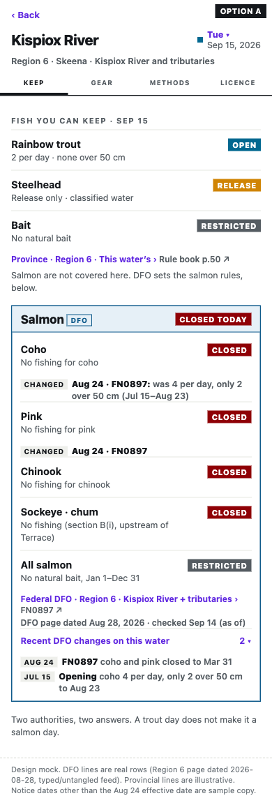
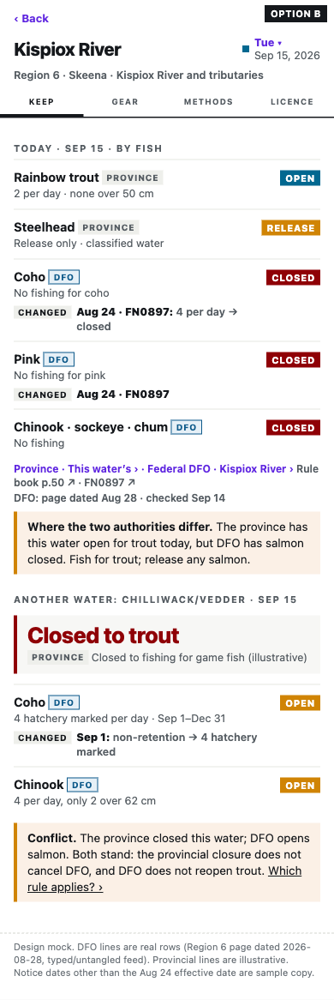
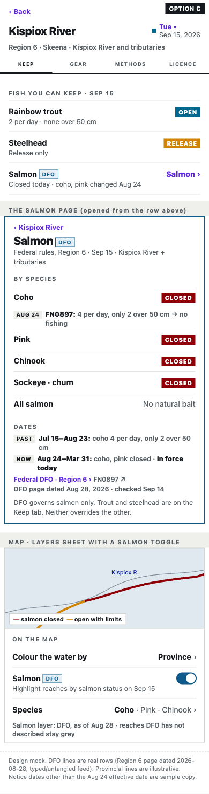

# T211: DFO salmon in the app, and the DFO feed (plan for the owner)

Status: PLAN. Parts 1 and 2 need the owner to pick. Part 3 is measured here. Parts 3 and 4 as code wait for the owner.
Written 2026-10-27. Mocks are static HTML; nothing in the app changed.

## 1. Salmon in the app: three options

Sample: **Kispiox River, Region 6, Tue Sep 15 2026**. The DFO lines are real rows from the typed feed (page dated
2026-08-28). Coho and pink were 4/day Jul 15–Aug 23, then closed Aug 24–Mar 31 (FN0897). Chinook, sockeye and chum
are closed (section B(i)). No natural bait all year. The provincial lines, the "checked Sep 14" line and the second
water in B (a provincial closure on Chilliwack/Vedder) are illustrative.

| | A. Separate "Salmon (DFO)" card | B. Merged into the day's answer | C. Salmon page + map toggle |
|---|---|---|---|
| Mock | [option-a.html](option-a.html) ·  | [option-b.html](option-b.html) ·  | [option-c.html](option-c.html) ·  |
| What the angler sees on Sep 15 | The Keep tab shows the provincial rows as today. Below them is a framed card headed "Salmon · DFO · CLOSED TODAY", with one row per species and the bait line. | One list by fish. Trout and steelhead rows carry a PROVINCE badge; coho, pink and chinook/sockeye/chum rows carry a DFO badge. | One "Salmon · DFO · Closed today · coho, pink changed Aug 24 ›" row on Keep opens a Salmon page with species, past/now date windows and the source. The map's layers sheet gets a Salmon switch that colours reaches by salmon status for the picked day. |
| DFO dates and changes | Its own source line: "Federal DFO · Region 6 · page dated Aug 28 · checked Sep 14". A "CHANGED Aug 24 · FN0897: was 4/day…" chip sits on each row, and a "Recent DFO changes (2)" fold below. | The same CHANGED chip per row (reuses the existing dated change chip on gear/bait items). One combined source line names both authorities. | A PAST/NOW timeline on the Salmon page. The map legend says "DFO, as of Aug 28". |
| Conflicts with provincial rules | Not shown as conflicts. A fixed line says "Salmon are not covered here. DFO sets the salmon rules, below." Two authorities, two answers. | An amber "Where the two authorities differ" block, e.g. the province closes the water while DFO opens salmon: "Both stand: the provincial closure does not cancel DFO, and DFO does not reopen trout." | A fixed line on the Salmon page: "DFO governs salmon only… neither overrides the other." On the map, the salmon layer stands alone, so no conflict is drawn. |
| App components | `regs/GroupCard`, `SourceLine`, `ChangesLine` (ui-native) | `GroupCard`, `PlainRow`, `ChangesLine`, `ClosedNote`, and a new banner kind in `core/src/regs/banner.ts` (today only `closed` and `tidal`) | A new species page on the RegsScreen sheet pattern; map `LayersSheet`, `OptionRow`, `MapLegend` |
| Release size (estimate) | Bundle: a location → section table, about 346 locations, roughly 20–40 KB gz. Rules come from the feed (about 17 KB gz for all nine pages today), with a bundle snapshot of the same size as the offline fallback. | Same as A, plus a per-day conflict computation in core (code, not data) | A's data, plus a salmon status on each section feature for the map layer. That needs either a tile property (atlas rebuild) or the section table in the client, about +50–150 KB. |
| Risk | Lowest. DFO freshness and gaps stay inside one card. | Highest. A 58%-unplaced overlay inside the main answer reads as "no salmon rule here" where DFO does have one. Conflict wording is legal judgement. | Medium. The map layer greys 58% of DFO reaches today (see part 3). |

**Recommendation: A now, the C map toggle later.**
- The README's own rule is that the two authorities overlay and do not merge. A keeps that visible.
- A has its own as-of line on its own clock. The provincial answer comes from the release; salmon comes from a feed that may be days newer.
- An unplaced DFO location degrades inside the card: "DFO has salmon rules for this water we have not placed yet → DFO page".
- B's conflict sentences become our legal reading of two regimes. Leave them until extents are reviewed (T164).
- Add C's map toggle once coverage passes about 90%. Before then it mostly draws grey.

Questions for the owner:
- **Q-A:** pick A, B or C, or a mix.
- **Q-B:** for a water with DFO rules we have not placed, show "see DFO" or nothing?

## 2. The DFO feed

Ground truth (memory `dfo-salmon-churn-asymmetry`, `pipeline/regs/dfo_salmon/PLAN.md`):
- Waters almost never move: Region 6 had 77/77 over 2.3 years, and no Region 6 water seen since 2017 has disappeared.
- Rules turn over about 50% a year, in season, through fishery notices.
- Scope text drifts ("Highway 37 Bridge" → "bridge", sign counts flipping back and forth).
- Locations leave and come back with the fishery.

So the geography is curated once and ships in the bundle, and the rules are a feed. This is the gauge rule: "the bundle
says what a thing IS, a feed says what it is DOING" (`pipeline/docs/15-live-data-flow.md`).

**Cadence.**
- Regions 6, 1 and 3: every 6 h from Jun 1 to Oct 31, daily otherwise. These change in season, days apart.
- Regions 2, 5a, 5b and 7: daily. Regions 4 and 8: weekly.
- All nine pages take about 15 s, so cost is not the limit.
- The early exit is the per-page sha256 in `cache/dfo_salmon/manifest.json`, since bodies are byte-identical when unchanged. Do not trigger on `dateModified`: notices do not reliably move it.

**Pipeline per run.** It needs no `claude` CLI and spends no credits.

```
fetch.py (validate, atomic, keep last good)
  → hash unchanged? stop
  → parse → untangle.verify() → typed (feed.py, pure: fingerprint → rules)
  → publish: join fingerprint → location_id via the COMMITTED entries files (read-only)
  → reconcile (entries.reconcile): ok / drift / new / dormant / revived / section_moved / structural
  → diff vs the last published feed, per location_id and rule
  → write the feed dir; notify the owner on hold-worthy outcomes
```

**The join is the one design choice.** `feed.py` stays curated-free. A thin publish step joins the fingerprint to the
`location_id` with the committed entries JSON (about 590 KB, read-only), the way the gauge publisher reads `matches.json`.
- Result: a reworded scope that a curator confirms (a fingerprint appended to an entry) reaches the app on the next feed run, with no rebuild.
- The bundle ships only what the feed cannot change: `location_id → sections` (extent geometry), plus a snapshot of the rules for offline use.

**Diff.** For each `location_id`: rules added, removed or changed (species, window, limit, gear, FN).
- DFO gives no notice dates, so the feed records **first-seen** as our scrape date next to the rule's own effective window.
- That is what the CHANGED chip prints: "Aug 24 (effective) · noticed Aug 25".
- The changes are appended to `changes.json`, a rolling 365 days, which feeds A's "Recent DFO changes".

**Storage, like the gauge feed.**

```
local   data/generated/regs/dfo_salmon/feed/      index.json        {location_id: {status_by_species_today?, rules[], first_seen}}  ~20 KB gz
                                                  region-<slug>.json full typed rules + preamble + date_modified
                                                  changes.json      rolling 365-day diff log
                                                  unplaced.json     rules held because their fingerprint has no location (part 4)
        data/generated/regs/dfo_salmon/feed.notified.json   BESIDE the feed dir, never synced (as gauges)
        cache/dfo_salmon/history/<slug>_<ts>.html  every changed page kept, which is the regression corpus (and part 3's input)
R2      feeds/dfo/  ← sync ONLY the feed dir (same owner-run sync as feeds/gauge)
app     dev: served by app/tools/serve-tiles.mjs like gauge/; prod: the R2 origin. The bundle carries a snapshot; the app uses whichever is newer.
```

**How a rule change reaches the app with no rebuild.**
1. DFO edits a page.
2. The next run sees a new hash, re-types the rules and joins them to the existing `location_id`s.
3. It writes the feed, and the sync pushes it to R2.
4. The app fetches `feeds/dfo/index.json` (on open, or once per day in view) and paints the card from it.

A rebuild is needed only when an extent changes, i.e. a newly placed location. That is the reach-only rerun plus the
bundle (memory `reach-only-rerun`), not an atlas rebuild.

**Failures.**

| What fails | Behaviour |
|---|---|
| Fetch fails or hits a WAF page | Keep the last good page and the last feed. Region marked stale in `index.json`. Two failed runs in a row → notify. |
| Parse or `verify()` fails | Hold the region at the last good feed, notify, and store the page in history for a fixture. |
| Structural (section set changed, >20% count move, >25% unbound) | Hold the whole region at the last good feed and notify. Never publish a rebuilt table unreviewed. |
| `section_moved` | Hold that location and notify. It re-scopes everything under it. |
| New or drifted fingerprint | Part 4: rules go to `unplaced.json` (never dropped) and the owner is notified once per fingerprint. Other locations publish normally. |
| Feed unreachable in the app | Use the bundle snapshot. The card's as-of line shows the older date. |
| App staleness | `core/src/staleness.ts` has `dfo: 120 days`. Tighten it to about 3 days for the feed in season, and keep 120 for the bundle snapshot. |

**The owner's role.**
- One-time: the cron host, `FEED_NOTIFY_URL` (already used by the gauges) and the R2 sync credentials for `feeds/dfo/`.
- Per alert: open the DFO review mode (T164). Confirm a drift rebind (appends a fingerprint, so it reaches the app on the next feed run) or place a new location (extent, then Claude does the reach-only rerun and bundle, then the owner uploads the release).
- Expected volume, from history: a few new locations a year. A structural break has happened once in nine years.

## 3. Historic matching coverage: measured 2026-10-27

**Input.** Every DFO page version in the repo data:
- `cache/dfo_salmon/history/`: 50 Wayback snapshots, 2017–2026, with 1–11 per region.
- `cache/dfo_salmon/raw/`: the 9 live pages.
- The 3 Region 6 fixtures in `pipeline/tests/fixtures/dfo_salmon/`.

All 62 versions parse. Each is re-parsed with today's parser, split into locations, and looked up by fingerprint in
the curated entries. "Matched to an extent" means:
- the entry exists (a variant follows its `duplicate_of`),
- its water is bound to a registry item,
- and `binding.extents` is not empty (`{op: whole}` counts).

Reproduce with `handoff/PLAN/dfo-salmon-ui/measure_coverage.py <out.json>` (paths in the script are absolute).

| Region | Versions | Locations ever seen | Matched to an extent | Unmatched |
|---|---:|---:|---:|---:|
| 1 | 10 | 81 | 33 | 48 |
| 2 | 10 | 66 | 18 | 48 |
| 3 | 2 | 9 | 3 | 6 |
| 4 | 2 | 1 | 1 | 0 |
| 5a | 4 | 4 | 0 | 4 |
| 5b | 7 | 13 | 7 | 6 |
| 6 | 15 | 163 | 85 | 78 |
| 7 | 6 | 2 | 0 | 2 |
| 8 | 6 | 7 | 0 | 7 |
| **All** | **62** | **346** | **147 (42%)** | **199** |

- **Every historic location is already known.** All 346 fingerprints ever published hit an entry, because `seed_from_history` seeded the superset. None is unknown, so the gap is extents, not identity.
- **Live (active) locations: 116/247 matched (47%).**
- **The 99 dormant locations: 31 matched (31%).**
- **The 199 gaps:**
  - 198 have the water bound to a registry item but no extent authored yet.
  - 1 water is still pending: Sheldens Creek, Region 6, "upstream of … signs at the Spur 19 Bridge site".
- **Gaps by kind of scope** (keyword classing, rough):

| Class | Live | Dormant | What it needs |
|---|---:|---:|---|
| whole-water scope ("including tributaries.", "all waters unless indicated below") | 34 | 2 | Cheap. `bind_whole` only fills empty scopes; a variant that accepts a tributary-only scope binds these with `tributaries: true`. **About 36 of 199 in one pass**, after the owner agrees. |
| landmark cut (bridge, confluence, outlet, falls, dam, street) | 54 | 34 | The T164 split placement (96 + 7 cut points proposed) |
| sign or point cut (signs at N m, weir, fence, hatchery) | 28 | 21 | Owner review. Many narrow the extent (spatial caveat), so never bind whole. |
| other | 15 | 11 | Read one by one |

The full list is [coverage-gaps.tsv](coverage-gaps.tsv): region, location_id, status, last seen, gap, class, water and
scope. It is sorted with live rows first.

**Corpus limits.**
- Regions 3 and 4 have one archived snapshot each.
- Region 6 has nothing between 2018-05 and 2020-04, or between 2020-04 and 2022-05.
- A location that appeared and vanished inside those gaps is not in the 346. The feed's own history dir closes this from now on.

## 4. What the new-location alert keys on (for when it is built)

- **Key: the location fingerprint** = sha256(`section | normalize(water) | normalize(scope)`)[:16], looked up in `EntryFile.by_fingerprint()`. It already absorbs case, punctuation and abbreviation drift. A miss is exactly `reconcile()`'s `drift` (a near candidate on the same water) or `new` (none).
- **Dedupe: notify once per (region, fingerprint).** The notified set lives beside the feed dir, as `notify.py` does for HYDAT.
- **Message:**
  - drift: "Region 6: new wording on Kispiox River, likely <location_id> (0.91) — confirm in DFO review".
  - new: "Region 6: new location on <water>: '<scope>' — N rules held unplaced".
- **A second, separate key: a new water name** (`names.key(water)` not in `waters[]`). It is louder, because the registry binding is missing too.
- **Do NOT alert on "known but no extent"** (the 199 above). That is the T164 backlog, not news. Alerting on it would fire on most of the feed every run. It belongs in the review queue, and the app shows those as "see DFO" (Q-B).
- **Never drop rules:** the location's rules go to `unplaced.json` with the page date. Once a curator confirms the fingerprint, the next run moves them into `index.json`, with no rebuild.
- **Test feed:** a copy of today's Region 6 page with one scope reworded, e.g. "upstream of Highway #16 bridge" → "upstream of the Highway 16 crossing" (drift; note "Hwy 16 Bridge" normalises to the same fingerprint and is correctly NOT an alert), and one invented water row (new). Assert both are held in `unplaced.json`, the notifier is called once each, and every other location publishes.
